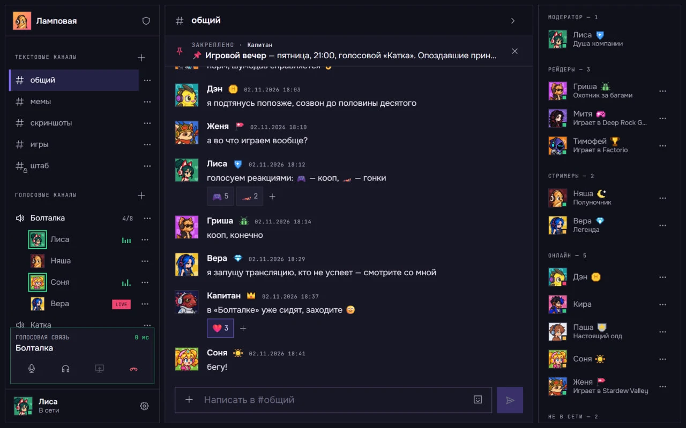

<h1 align="center">
  
</h1>

<p align="center">
  <a href="README.md">Русский</a> | <strong>English</strong>
</p>

A self-hosted, Discord-style messenger: text channels, voice (up to 8 people), screen sharing, roles, reactions and profile cosmetics. One server hosts one community. The client is a web app that runs in the browser.



> The installer and the `hooba` command currently talk to you in Russian. The steps below describe what they do.

## Installation

Run one command on your server. The script downloads Hooba to `/opt/hooba`, installs everything it needs and starts the server:

```bash
bash <(curl -Ls https://raw.githubusercontent.com/blackpiest/hooba-app/main/install.sh)
```

If you don't have a server yet or don't know where to type the command, see [what you need](#what-you-need) and [how to connect to your server](#how-to-connect-to-your-server) below.

If you get `curl: command not found`, run `apt update && apt install -y curl` first.

The script walks you through the setup: it asks how the server should be reached (by domain or by IP) and how much disk space to give to chat images, issues a certificate, offers nightly backups and starts the server. The first build takes 5–15 minutes. At the end it shows the address and a setup token: open `https://<domain-or-IP>/setup`, enter the token and create the community owner.

If the installation stops with an error, the script tells you what to check. Once you've fixed the cause, run the same command again: the steps already completed won't be harmed.

<details>
<summary>Manual installation with git</summary>

```bash
apt update && apt install -y git
git clone https://github.com/blackpiest/hooba-app.git /opt/hooba
cd /opt/hooba
chmod +x install.sh
./install.sh install
```

After installation, the `hooba` command becomes available (see [Maintenance](#maintenance)).

</details>

## What you need

- A Linux VPS (Ubuntu 22.04+ or Debian 12+) with at least 2 GB of RAM (with 1 GB the script offers to enable swap), at least 10 GB of disk space and a public IPv4 address
- A domain with an A record pointing to the server's IP, **or no domain at all**: the server can be opened directly by IP, and a certificate for the IP is issued and renewed automatically

The script installs Docker, certbot, git and everything else if they are missing.

If your hosting provider has a firewall in its control panel (Firewall, Security groups), open these inbound ports, otherwise the certificate won't be issued and voice won't work:

| Port | Protocol | Purpose |
|---|---|---|
| 80, 443 | TCP | website |
| 3478 | UDP + TCP | voice (TURN/STUN) |
| 5349 | TCP | voice over TLS |
| 40000–40100 | UDP + TCP | voice |
| 50000–50100 | UDP | voice (relay) |

## How to connect to your server

After you buy a VPS, the hosting provider sends you an IP address, a login (usually `root`) and a password. The installation command is entered in the **server's** terminal, which you can reach from your computer:

- **Windows**: open PowerShell (Start → "PowerShell")
- **macOS / Linux**: open Terminal

and enter the following (replace `<IP>` with the server's address):

```bash
ssh root@<IP>
```

On the first connection, answer `yes`, then enter the password from your hosting provider's email (the characters aren't displayed as you type, which is normal). When the prompt changes to something like `root@server:~#`, you are on the server.

## Save your passwords

The file `/opt/hooba/infra/docker/.env.prod` contains the server's passwords. Without it, a database backup can't be restored on a new server. Download it to your computer. Run this command **on your computer**, in a new PowerShell or Terminal window, not on the server:

```bash
scp root@<IP>:/opt/hooba/infra/docker/.env.prod .
```

The file appears in the folder where the terminal is open (on Windows, usually `C:\Users\<name>`). Never show it to anyone.

Download your backups the same way from time to time:

```bash
scp -r root@<IP>:/opt/hooba/backups .
```

## Maintenance

The server is managed with the `hooba` command, which you can run on the server from any folder. The easiest way is to type just `hooba`: it opens a menu where you choose an action by number. The menu looks like this (translated from Russian):

```text
  Server operation
    1) Status: is everything OK
    2) Start the server
    3) Stop the server
    4) Repair: restart everything from scratch (data is not touched)
  ...
    0) Exit
```

The same actions can also be run directly:

```bash
hooba status      # is everything OK: containers, certificate, disk, backups
hooba update      # update to the new version (a database backup is made automatically)
hooba rollback    # go back to the previous version if the new one doesn't work
hooba repair      # if something has stopped working
hooba logs        # the log helps find the cause of a problem
hooba voice-check # why members can't hear each other; collects a report without passwords
hooba backup      # back up the database, settings and images (/opt/hooba/backups)
hooba restore     # restore from a backup
hooba uploads-quota 10   # disk space for chat images, GiB
hooba help        # all commands
```

If a command fails, the script tells you at which step and what to check. The full log of every command is in `/opt/hooba/logs`. Once you've fixed the cause, just run the command again.

If `hooba` isn't found (`command not found`), the same thing works like this: `/opt/hooba/install.sh status`. The first run as root re-enables the `hooba` command.

## Bugs and suggestions

Found a bug or have an idea? [Open an issue](https://github.com/blackpiest/hooba-app/issues/new/choose). Installation and setup questions are covered in the [documentation for Hooba server owners](https://docs.hooba.space/en/).

Report vulnerabilities only privately, see [SECURITY.md](SECURITY.md).

This repository contains Hooba releases for installing on your own server. Pull requests are not accepted: describe the problem in an issue and the author will make the fix.

## License

Copyright (C) 2026 Egor Redchenko

Hooba is distributed under the [GNU AGPL-3.0](LICENSE) license, which covers the code, graphics and sounds. If you have modified Hooba and given other people access to your server, you must provide them with the source code of your version under the same terms.

The Onest and Unbounded fonts are distributed under the SIL Open Font License 1.1.

The "Hooba" name and logo are not covered by the license. If you distribute a modified version, give it a different name and do not present it as the official one.
