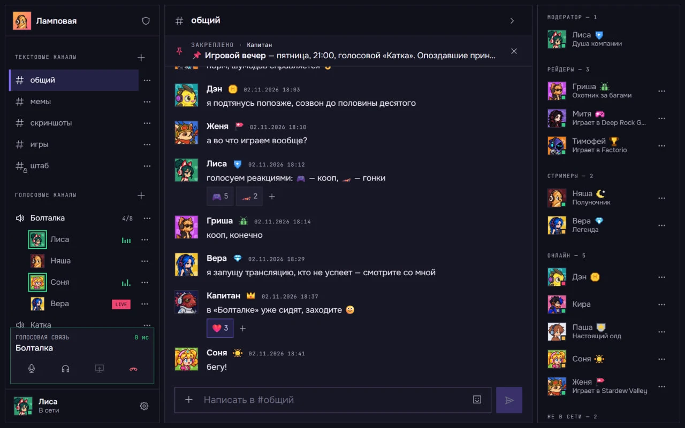

<h1 align="center">
  
</h1>

<p align="center">
  <strong>Русский</strong> | <a href="README.en.md">English</a>
</p>

Self-hosted мессенджер в духе Discord: текстовые каналы, голос (до 8 человек), демонстрация экрана, роли, реакции, косметика профиля. Один сервер — одно сообщество. Клиент — веб-приложение в браузере.



## Установка

Одна команда на сервере — скрипт сам скачает Hooba в папку `/opt/hooba`, установит всё нужное и запустит сервер:

```bash
bash <(curl -Ls https://raw.githubusercontent.com/blackpiest/hooba-app/main/install.sh)
```

Сервера ещё нет или не знаете, куда вводить команду, — ниже [что нужно](#что-нужно) и [как подключиться к серверу](#как-подключиться-к-серверу).

Если появилась ошибка `curl: command not found`, сначала выполните `apt update && apt install -y curl`.

Скрипт по шагам спросит, как открывать сервер (по домену или по IP) и сколько места отдать под картинки чата, выпустит сертификат, предложит ночные резервные копии и запустит сервер. Первая сборка занимает 5–15 минут. В конце он покажет адрес и токен настройки: откройте `https://<домен-или-IP>/setup`, введите токен и создайте владельца сообщества.

Если установка остановилась с ошибкой, скрипт напишет, что проверить. Исправив причину, запустите ту же команду ещё раз — уже сделанное не пострадает.

<details>
<summary>Установка вручную через git</summary>

```bash
apt update && apt install -y git
git clone https://github.com/blackpiest/hooba-app.git /opt/hooba
cd /opt/hooba
chmod +x install.sh
./install.sh install
```

После установки появится команда `hooba` (см. «Обслуживание»).

</details>

## Что нужно

- VPS с Linux (Ubuntu 22.04+ или Debian 12+), от 2 ГБ памяти (на 1 ГБ скрипт предложит включить swap), от 10 ГБ диска, внешний IPv4
- Домен с A-записью на IP сервера — **или без домена**: сервер можно открывать прямо по IP, сертификат на IP выпускается и продлевается автоматически

Docker, certbot, git и прочее скрипт установит сам, если их нет.

Если у хостинга есть брандмауэр в панели (Firewall, Security groups, «Сетевой экран»), откройте входящие порты — иначе сертификат не выпустится, а голос не заработает:

| Порт | Протокол | Зачем |
|---|---|---|
| 80, 443 | TCP | сайт |
| 3478 | UDP + TCP | голос (TURN/STUN) |
| 5349 | TCP | голос через TLS |
| 40000–40100 | UDP + TCP | голос |
| 50000–50100 | UDP | голос (relay) |

## Как подключиться к серверу

После покупки VPS хостинг присылает IP-адрес, логин (обычно `root`) и пароль. Команду установки вводят в терминале **сервера**, а попасть туда можно с вашего компьютера:

- **Windows** — откройте PowerShell (Пуск → «PowerShell»)
- **macOS / Linux** — откройте «Терминал»

и введите (вместо `<IP>` — адрес сервера):

```bash
ssh root@<IP>
```

При первом подключении ответьте `yes`, затем введите пароль из письма хостинга (символы при вводе не отображаются — это нормально). Когда строка сменится на что-то вроде `root@server:~#`, вы на сервере.

## Сохраните пароли к себе

В файле `/opt/hooba/infra/docker/.env.prod` — пароли сервера. Без него резервную копию базы на новом сервере не восстановить. Скачайте его на свой компьютер — команду вводите **на компьютере**, в новом окне PowerShell или Терминала, не на сервере:

```bash
scp root@<IP>:/opt/hooba/infra/docker/.env.prod .
```

Файл появится в папке, где открыт терминал (в Windows обычно `C:\Users\<имя>`). Никому его не показывайте.

Так же время от времени скачивайте резервные копии:

```bash
scp -r root@<IP>:/opt/hooba/backups .
```

## Обслуживание

Сервером управляет команда `hooba` — её можно вводить на сервере из любой папки. Проще всего набрать просто `hooba`: откроется меню, где действие выбирается номером.

```text
  Работа сервера
    1) Статус: всё ли в порядке
    2) Запустить сервер
    3) Остановить сервер
    4) Починить: перезапустить всё заново (данные не трогаются)
  ...
    0) Выход
```

Те же действия можно запускать и напрямую:

```bash
hooba status      # всё ли в порядке: контейнеры, сертификат, диск, копии
hooba update      # обновиться до новой версии (копия базы делается сама)
hooba rollback    # вернуть прежнюю версию, если новая не заработала
hooba repair      # если что-то перестало работать
hooba logs        # журнал — поможет найти причину проблемы
hooba voice-check # почему участники не слышат друг друга; собирает отчёт без паролей
hooba backup      # резервная копия базы, настроек и картинок (/opt/hooba/backups)
hooba restore     # восстановить из копии
hooba uploads-quota 10   # место под картинки чата, ГиБ
hooba help        # все команды
```

Если команда завершилась ошибкой, скрипт напишет, на каком шаге и что проверить. Полный журнал каждой команды — в папке `/opt/hooba/logs`. После исправления причины команду можно просто запустить ещё раз.

Если `hooba` не находится (`command not found`), то же самое работает так: `/opt/hooba/install.sh status`. Первый же запуск под root снова включит команду `hooba`.

## Ошибки и предложения

Нашли ошибку или есть идея — [создайте issue](https://github.com/blackpiest/hooba-app/issues/new/choose). Вопросы по установке и настройке разобраны в [документации для владельцев сервера Hooba](https://docs.hooba.space).

Уязвимости — только приватно, см. [SECURITY.md](SECURITY.md).

Этот репозиторий — выпуски Hooba для установки на свой сервер. Pull request не принимаются: опишите проблему в issue, исправление сделает автор.

## Лицензия

Copyright (C) 2026 Egor Redchenko

Hooba распространяется по лицензии [GNU AGPL-3.0](LICENSE) — код, графика и звуки. Если вы изменили Hooba и открыли доступ к своему серверу другим людям, вы обязаны дать им исходный код своей версии на тех же условиях.

Шрифты Onest и Unbounded распространяются по лицензии SIL Open Font License 1.1.

Название «Hooba» и логотип не входят в лицензию. Изменённую версию, которую вы распространяете, назовите иначе и не выдавайте за официальную.
